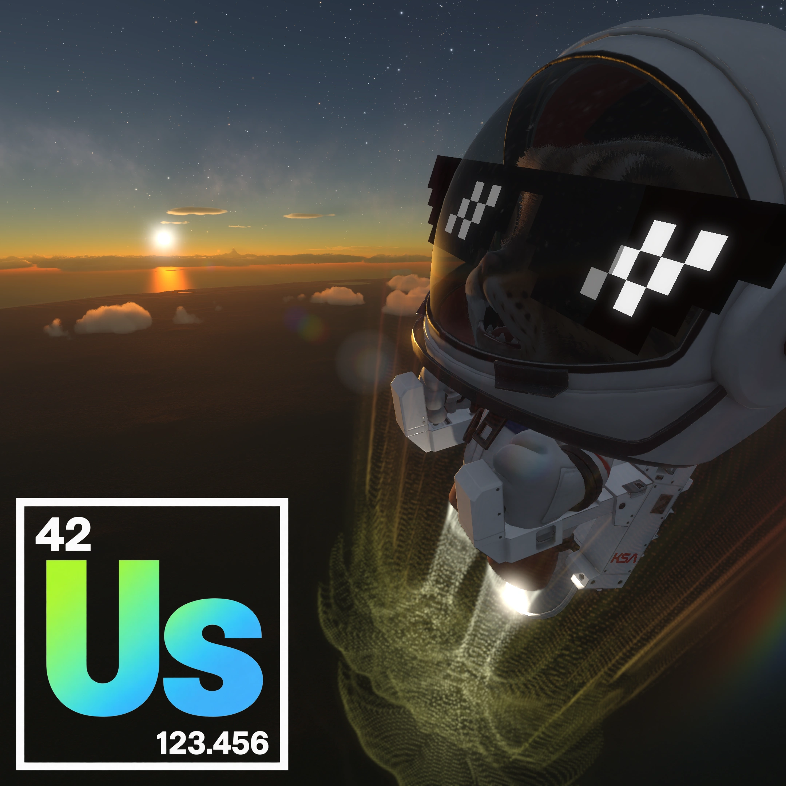
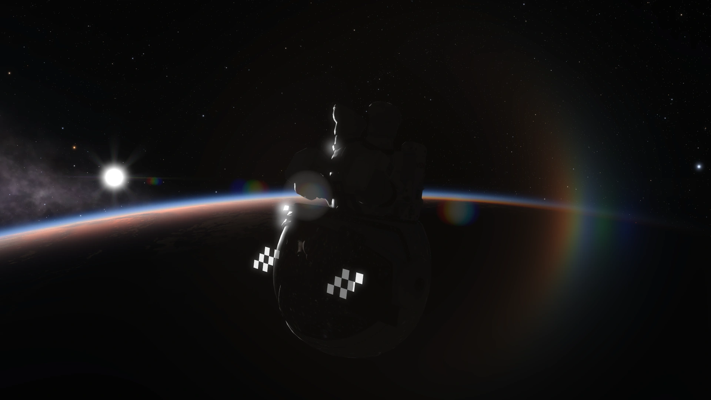
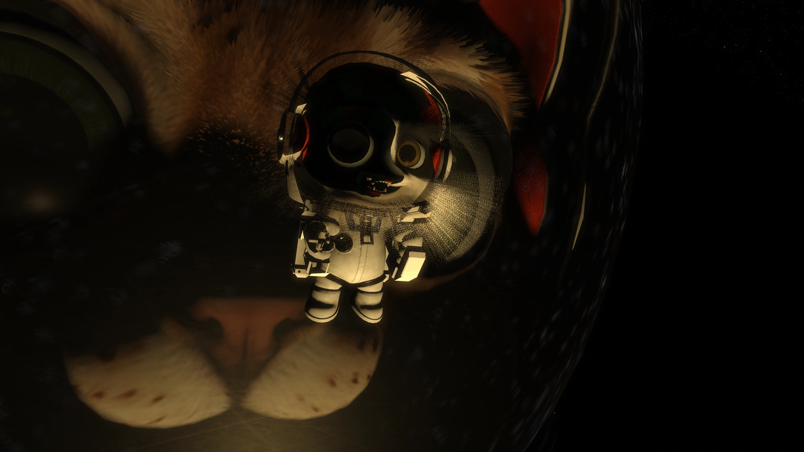
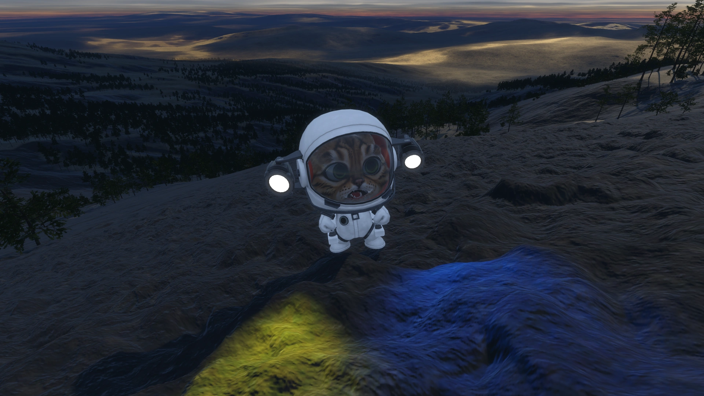
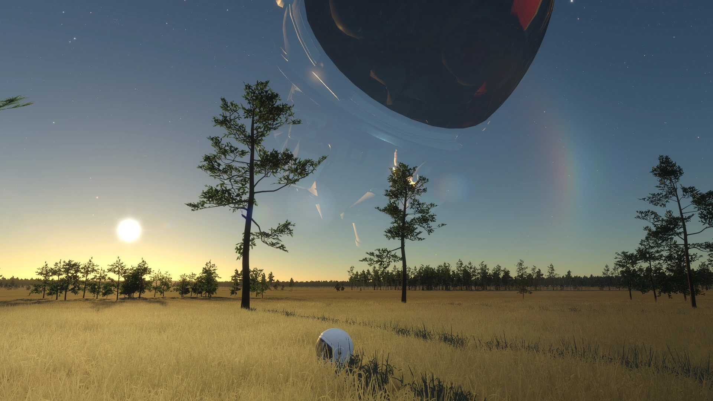
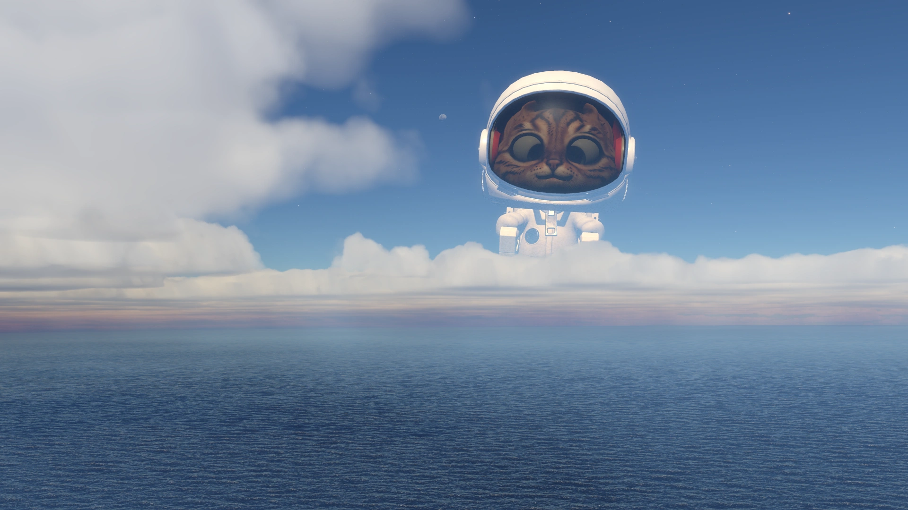
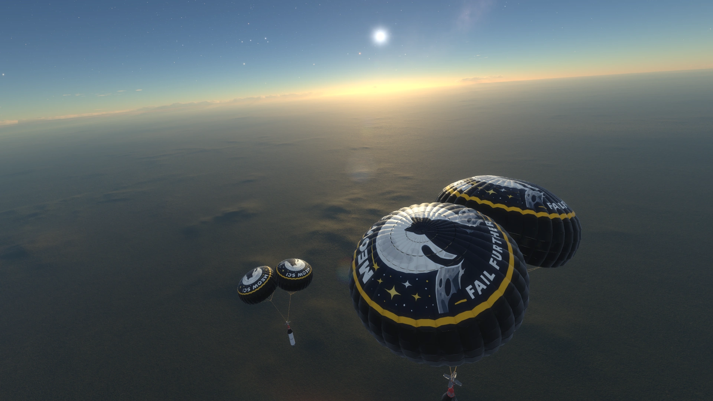

# unscience

The Unscience entry module uses the [shared runtime bootstrap](Shared/README.md) for early default-context networking preload and one assembly/path/context report before submod construction. Networking incompatibility is reported without disabling unrelated submods. No scene-save IDs, payloads, ownership APIs or hooks change.

**unscience** is a Kitten Space Agency mod that lets you do ubsurd, silly things to KSA.

It breaks physics, moves things around, resizes things, makes noises, changes colors and textures, and much more.

I describe it as a *supermod* that includes a suite of *submods*, each one has a fun unique name tangentially related to what it does, usually from some kind of pop culture reference.

**You Didn't See Anything** keeps ImGui windows visible when **F2** hides the game UI. Enable it
in the toolbox, then optionally select **Detached OS windows only** and **Hide stock gauges**.
It starts disabled; its flags travel with scene saves. Native viewport/input acceptance is pending.
[Controls and implementation](you-didnt-see-anything.lib/README.md).

DOH's **Smite / Smite All** now use [KSA's native kill input](plans/DOH_NATIVE_KILL_5801.md),
replacing custom despawning. Native dispatch removes the kitten before the render list is rebuilt;
War Paint releases its private materials after death and preserves saved presets. The native cause
is **Abandoned** (custom reason strings are unsupported). Default offset remains **(1, 1, -2) m**.
The earlier [shutdown cleanup fix](plans/DOH_DESPAWN_5801_FOLLOWUP.md) remains; native retesting is pending.
Its spawned-kitten table has **Name**, **Model** and red **Smite** actions, with full-width
**Smite All** below. Spawn/refresh share equal-width buttons; feedback uses KSA's logger instead
of persistent status/count labels. Scene-save behavior is unchanged.

DOH spawns now join the native kitten roster with an active EVA mission and launched status.
KSA maintains crew health/statistics, boarding, recovery and KIA history; older tracked DOH kittens
are repaired on restore and while live. [Native roster integration](plans/DOH_ROSTER_INTEGRATION.md).

**War Paint** is the central kitten coloring submod. Create/select a named preset, preview its
material colors on all assigned kittens, save changes, and apply it to multiple EVA kittens.
The apply-all and per-material color pickers both support alpha editing and previews.
Confirmed preset deletion removes matching paint; red X buttons restore individual kittens.
Presets persist across scenes/restarts; DOH assigns them when spawning. Dialogs have explicit
padding and live name validation; the multi-kitten picker and material table are larger. Partial
material catalogs retry, and the preset combo supports clearing selection. War Paint owns the global
**Show visor glass** checkbox above Live War Paint; action feedback uses KSA's logger. Existing
visor saves and legacy kitten colors remain compatible.
[Controls and ownership](war-paint.lib/README.md) · [layout and native acceptance](plans/WAR_PAINT_PRESET_EDITOR.md).

Humble Arteest's immediate white vessels on part-paint Enable remain unresolved; this is separate
from the working kitten coloring path. [Investigation](plans/HUMBLE_ARTEEST_5801_PAINT_INVESTIGATION.md).

# game compatibility

The current checkout targets **KSA 2026.11.10.5801**, upgraded from 2026.10.25.5707.
The whole solution and all 19 managed suites pass; native game acceptance remains pending.
This upgrade migrates the data-reference/key schema, preserves Iron Man anchors with legacy-save
migration, fixes DOH material resolution and Vehicle Paint/native-highlight collisions, preserves
Pebbles curvature/terrain blending, and updates Pyro for runtime SI atmospheres. Native pipeline
allocations are explicitly disposed. Existing sidecar IDs/versions stay compatible.
See [KSA_5801_UPGRADE](plans/KSA_5801_UPGRADE.md), [player compatibility](unscience/README.md#ksa-compatibility)
and [ISSUES.md](ISSUES.md). Prior upgrade evidence: [5707](plans/KSA_5707_UPGRADE.md).

The October 25 startup follow-up fixes Full Canopy parsing of Windows shader line endings,
orders the shared physics handoff before existing call-wrapping transpilers, and reports complete
patch errors with a measured startup summary. The handoff serves welding, Dent Wizard, Godzilla
and scene saves. Disabling only purr2d2 on the original installed build removes the shared-hook
failures and restores welding. The updated build still needs testing with purr2d2 re-enabled.
See the [startup follow-up](plans/KSA_5638_UPGRADE.md#startup-follow-up-2026-10-25).

The Purr2D2 source audit also adds a companion deferred-load cleanup correction and same-kitten
input ownership: Iron Man rocket mode owns Space, and Purr2D2 cancels somersaults before changing a
vessel-mode worker. The paired source tests are separate from native co-loaded acceptance.

Kitchen Sink includes **Unlock IVA Camera**: enter IVA, enable the toggle, and use free cam
movement while retaining IVA interiors, lighting and configured ray tracing. Turning it off or
using **Return to Seat** restores the seated camera. Speed and the unlocked view are scene-saved.
See [Kitchen Sink controls](kitchen-sink/README.md#unlock-iva-camera).

Kitchen Sink also offers **See Inside Capsule (Experimental)**, off by default: it hides the
stock medium capsule's two opaque window surfaces and reveals its existing IVA cabin/glass.
The switch is scene-saved and reversible; native visual acceptance is pending. See
[the experiment](kitchen-sink/README.md#capsule-glass-experiment).

DOH's spawn controls include an editable vehicle name / batch prefix, initially `Kitten_doh_`.
Single spawns use the text exactly, batches append numbers, and blank input uses automatic naming.
The setting is scene-saved. See [DOH usage](doh/README.md#usage).

Kitten Animations keeps holds and animation settings independently for each EVA kitten, even after
switching control or the camera to another vessel. Select a kitten in the panel to edit or clear
its holds. Scene saves restore all configured kittens. See [Kitten Animations](kitten-animations/README.md).

# releases

GitHub Actions uses `1.${GITHUB_RUN_NUMBER}.0` for stable releases from `main`
and `1.${GITHUB_RUN_NUMBER}.0-beta` for prereleases from `feature/*` branches.
The major version is fixed at `1` and the patch version at `0`. The same version
is used in `mod.toml`, the release title, and the ZIP filename; Git tags add a `v`
prefix. Reruns preserve an existing release. After publishing, main retains its
10 newest releases and all beta branches share the five newest prereleases.
Older releases and their tags are deleted, including releases using the previous
date-based main and timestamp-based feature formats. Other branches build only.

# media

